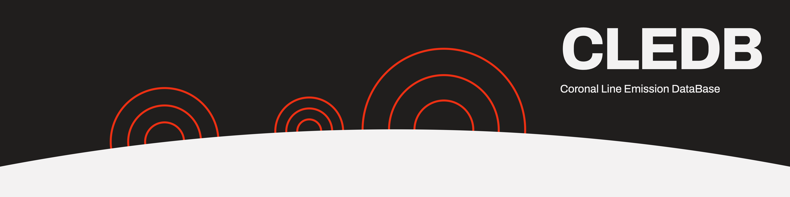

.. solar-coronal-inversion documentation master file, created by sphinx-quickstart.

Documentation for the **CLEDB** Distribution
============================================
.. image:: https://img.shields.io/badge/GitHub-arparaschiv%2Fsolar--coronal--inversion-blue.svg?style=flat
   :target: https://github.com/arparaschiv/solar-coronal-inversion
   :alt: CLEDB repository

------------------------------------------------------

**Purpose:**

The **C**\ oronal **L**\ ine **E**\ mission **D**\ ata\ **B**\ ase inversion is a **public** and open-source Python based tool and pipeline that is used to infer magnetic field information from spectro-polariemtric observations of the solar corona. This document describes the main concepts, workflows, functions, and variables, comprising the CLEDB inversion algorithm for inverted coronal magnetic fields.

-----------------------------------------------------------------------------

**Authors and Contact:**

| Alin Paraschiv and Philip Judge
| -- High Altitude Observatory, NCAR|UCAR
| -- National Solar Observatory, AURA

.. | arparaschiv *at* nso edu  or paraschiv.alinrazvan+cledb *at* gmail

-----------------------------------------------------------------------

.. Check out the :doc:`usage` section for further information.

.. caution::
   Vector coronal magnetometry is not yet advanced enough as to recover HMI-like magnetograms. A user should not expect such a product yet. Solution degeneracies exist, and the user is required to make a decision on how to interpret the inversion outputs and which products to utilize for their science goals.

.. Danger::
   This setup should be considered at best a beta-level release. CLEDB tackles a problem for which currently only scarce observational data exists and where a complex forward-model type of inversion is required. Bugs or unintentional bad outcomes will still exist at this point in time. Please get in touch with us about any "feature" you discover.

.. toctree::
   :maxdepth: 3
   :caption: Contents:

   synopsis
   module_overview
   install
   inputvars
   cledb_build
   cledb_prepinv
   cledb_proc
   outputs
   changelog
   glossary
   readmes
   api_reference

..
   Indices and tables
   ==================

   * :ref:`genindex`
   * :ref:`modindex`
   * :ref:`search`
